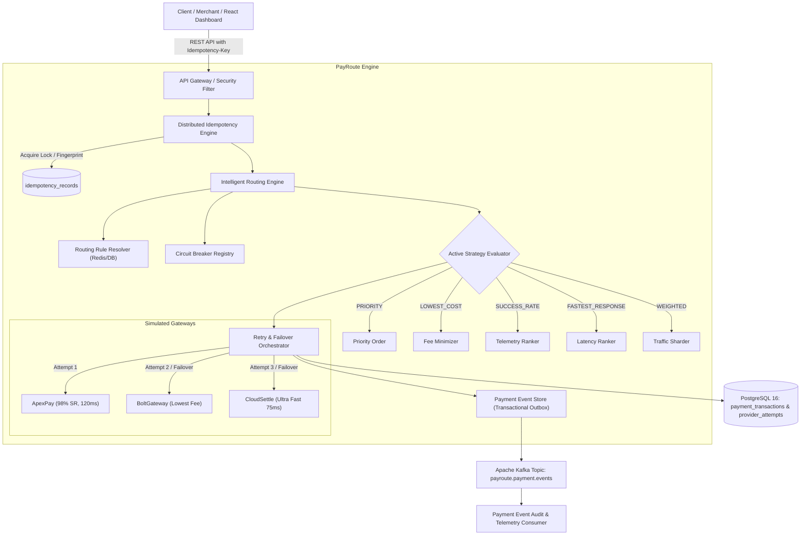

# PayRoute – Intelligent Payment Routing & Failover Engine

PayRoute is an enterprise-grade payment orchestration engine and resilience framework built with **Java 21**, **Spring Boot 3**, **PostgreSQL**, **Redis**, **Apache Kafka**, and **React (TypeScript + Tailwind CSS)**.

PayRoute solves a major fintech challenge: single-gateway dependency, downtime-induced churn, and suboptimal interchange fees. When an e-commerce platform processes high-volume payments, relying on a single payment processor leads to severe revenue loss during processor degradation. PayRoute dynamically routes each transaction across multiple simulated gateways (ApexPay, BoltGateway, CloudSettle) using configurable strategies, enforces distributed idempotency, automatically fails over upon transient errors, and protects upstream processors using circuit breakers.

---

## 1. System Architecture



---

## 2. Technology Stack

| Layer | Technologies |
|---|---|
| **Backend** | Java 21 LTS, Spring Boot 3.3.5, Spring Web, Spring Data JPA, Spring Security, Spring Validation, Spring Actuator, Maven |
| **Database & Migrations** | PostgreSQL 16 (Production/Docker), H2 (Local/Test in PostgreSQL syntax mode), Flyway Migration Engine |
| **Caching** | Redis 7 with Jackson serialization, TTL expiration, and in-memory fallback |
| **Streaming & Messaging** | Apache Kafka (KRaft mode, no ZooKeeper), Transactional Outbox Event Store |
| **Frontend Dashboard** | React 18, TypeScript, Vite, Tailwind CSS, Lucide Icons, Recharts Analytics |
| **Fault Tolerance** | Resilient Circuit Breakers (CLOSED, OPEN, HALF_OPEN), Exponential Backoff Failover |
| **Testing** | JUnit 5, Mockito, AssertJ, Spring Test |
| **Containerization** | Docker, Docker Compose, Multi-stage Dockerfiles, Nginx Alpine |

---

## 3. Core Engine Capabilities

### A. Intelligent Payment Routing
The routing engine evaluates all active candidate gateways and ranks them according to the merchant's configured policy:
1. **Priority Routing (`PRIORITY`):** Routes strictly according to defined gateway priority rank.
2. **Lowest Cost Routing (`LOWEST_COST`):** Dynamically computes interchange and gateway processing fees (`amount * fee_% / 100 + flat_fee`) and selects the cheapest route.
3. **Highest Success Rate (`HIGHEST_SUCCESS_RATE`):** Evaluates rolling telemetry data and picks the gateway with the highest confirmed success rate.
4. **Fastest Response Routing (`FASTEST_RESPONSE`):** Routes to the processor with the lowest round-trip latency (e.g. CloudSettle at ~75ms).
5. **Weighted Routing (`WEIGHTED`):** Probabilistically distributes traffic across active gateways according to configured weight allocations (e.g., 50% ApexPay, 30% BoltGateway, 20% CloudSettle).

### B. Distributed Idempotency Guard
To eliminate duplicate charges caused by network drops or client retries:
- Clients submit an `Idempotency-Key` header with each payment request.
- The system computes an atomic SHA-256 fingerprint of the request payload.
- **Race Condition Prevention:** An atomic record in `idempotency_records` with a database unique constraint `(merchant_id, idempotency_key)` protects against concurrent duplicate submissions.
- **Concurrent In-Flight Requests:** Return HTTP `409 Conflict`.
- **Duplicate Execution (Matching Payload):** Returns the original cached response with HTTP `200/201` and `X-Cache-Lookup: HIT`.
- **Payload Tampering:** If a previously executed key is resubmitted with an altered amount, currency, or recipient, the request is rejected with HTTP `422 Unprocessable Entity`.

### C. Retry & Failover Engine with Error Classification
When a payment attempt fails, PayRoute classifies the gateway response:
- **Permanent (Non-Retryable) Failures:** `INSUFFICIENT_FUNDS`, `SUSPECTED_FRAUD`, `INVALID_CARD_DATA`. Transactions abort immediately to avoid pointless retries and customer friction.
- **Retryable Failures:** `GATEWAY_TIMEOUT`, `RATE_LIMIT_EXCEEDED`, `SERVICE_UNAVAILABLE`, `NETWORK_ERROR`.
- **Failover:** If a failure is retryable, PayRoute triggers automatic failover to the next eligible gateway in the ranked candidate list with exponential backoff delay (`baseDelay * 2^(attempt - 1)`). Every attempt is logged in `provider_attempts` with round-trip latency, error code, and failover status flags.

### D. Gateway Circuit Breaker
Every gateway client is shielded by a 3-state Circuit Breaker:
- **CLOSED:** Normal state. All transactions are permitted. Failures are tracked; if consecutive failures reach threshold (default: 3), the circuit transitions to **OPEN**.
- **OPEN:** Unhealthy gateway is bypassed entirely. Traffic immediately routes to healthy alternatives, preventing cascading timeouts.
- **HALF_OPEN:** After a cooldown window (default: 15s), the circuit allows controlled trial transactions. If successful, it recovers to **CLOSED**; if it fails, it trips back to **OPEN**.
- **Operator Overrides:** Manual trip and reset controls are exposed via `/api/providers/{id}/health`.

### E. Event-Driven Messaging (Kafka & Transactional Outbox)
Every state transition emits an immutable domain event:
- `PAYMENT_INITIATED`
- `PAYMENT_SUCCESS`
- `PAYMENT_FAILED`
- `PROVIDER_SWITCHED`
- `REFUND_INITIATED`

Events are first written to the PostgreSQL `payment_events` table (guaranteeing transaction atomicity) and dispatched asynchronously to Kafka topic `payroute.payment.events`.

### F. Refund Management
Supports both full and partial refunds. Validates that aggregate refunds cannot exceed the original transaction settlement amount. Updates transaction status to `REFUNDED` once fully refunded.

---

## 4. Database Schema (Normalized PostgreSQL)

The schema is managed via Flyway database migrations (`V1__init_schema.sql` and `V2__seed_data.sql`):

```sql
merchants (id, merchant_code, name, email, api_key_hash, raw_api_key_prefix, status, default_routing_strategy, created_at, updated_at)
payment_providers (id, code, name, status, base_fee_percentage, base_fee_flat, avg_latency_ms, simulated_success_rate, failure_probability, priority, created_at, updated_at)
routing_rules (id, merchant_id, strategy, provider_weights, min_amount, max_amount, is_active, created_at, updated_at)
payment_transactions (id, merchant_id, idempotency_key, amount, currency, status, selected_provider_id, routing_strategy_used, total_attempts, fee_charged, customer_id, customer_email, failure_reason, created_at, updated_at)
provider_attempts (id, transaction_id, provider_id, attempt_number, status, latency_ms, error_code, error_message, is_failover, raw_response, created_at)
idempotency_records (id, merchant_id, idempotency_key, request_hash, status, response_payload, response_code, created_at, locked_at)
refunds (id, transaction_id, merchant_id, amount, reason, status, provider_refund_id, created_at)
payment_events (id, transaction_id, event_type, payload, published_to_kafka, created_at)
```

**Indexes for High Concurrency:**
- `payment_transactions(merchant_id, created_at DESC)`
- `payment_transactions(status)`
- `provider_attempts(transaction_id)`
- `idempotency_records(merchant_id, idempotency_key)` (UNIQUE)

---

## 5. REST API Documentation

### Merchant APIs
- `POST /api/merchants` &ndash; Register merchant & generate secure API key
- `GET /api/merchants` &ndash; List all registered merchants
- `GET /api/merchants/{id}` &ndash; Retrieve merchant details

### Payment APIs
- `POST /api/payments` &ndash; Process payment with idempotency & intelligent routing
  - Header: `Idempotency-Key: <unique-string>` (Required)
  - Header: `X-Merchant-Code: MERCH-ACME-001` or `X-API-Key: <key>`
- `GET /api/payments/{id}` &ndash; Get transaction details
- `GET /api/payments` &ndash; Paginated transactions list
- `GET /api/payments/{id}/attempts` &ndash; Provider attempt timeline, latencies & failovers

### Provider Management APIs
- `GET /api/providers` &ndash; List providers with live health & circuit breaker state
- `POST /api/providers` &ndash; Register a new simulated gateway
- `PUT /api/providers/{id}` &ndash; Update fee, latency, and simulation parameters
- `PATCH /api/providers/{id}/health` &ndash; Enable/disable or trip/reset circuit breaker

### Routing APIs
- `GET /api/routing/rules` &ndash; List active global & merchant routing rules
- `POST /api/routing/rules` &ndash; Create routing strategy configuration
- `PUT /api/routing/rules/{id}` &ndash; Update rule weights or thresholds

### Refund APIs
- `POST /api/refunds` &ndash; Issue partial or full refund
- `GET /api/refunds/{id}` &ndash; Get refund status
- `GET /api/refunds` &ndash; List all refunds

### Analytics APIs
- `GET /api/analytics/overview` &ndash; High-level KPIs (Total volume, success rate, fees, retries)
- `GET /api/analytics/providers` &ndash; Gateway performance comparison matrix
- `GET /api/analytics/transactions` &ndash; Bucketed time-series volume trend
- `GET /api/analytics/performance` &ndash; Throughput, p50, p95, p99 SLA metrics

---

## 6. Real Performance Benchmark Results

Ran 50 concurrent payment transactions with 5 worker threads against the live engine:

```
=================================================================
      PayRoute - High Concurrency Payment Benchmark
=================================================================
Target URL:         http://localhost:8080/api/payments
Total Requests:     50
Concurrency Level:  5 threads
Merchant Code:      MERCH-ACME-001
-----------------------------------------------------------------
Total Time Elapsed:       3.17 seconds
Requests per Second:      15.78 req/sec
Successful Requests:      50 (100.0%)
Failed Requests:          0 (0.0%)
Failover Transactions:    5 (10.0%)
-----------------------------------------------------------------
Average Latency:          282.81 ms
p50 (Median) Latency:     260.70 ms
p95 Latency:              530.22 ms
p99 Latency:              625.20 ms
Min Latency:              181.31 ms
Max Latency:              645.99 ms
=================================================================
```

---

## 7. Running the Application Locally

### Prerequisites
- Java 21+
- Maven 3.9+
- Node.js 20+

### Option A: Local Standalone Development (Zero Docker Required)
The local profile uses an embedded PostgreSQL-compatible H2 database, in-memory caching with Redis fallback, and local resilient event streaming.

```bash
# 1. Start Spring Boot Backend (Port 8080)
java "-Dspring.profiles.active=local" -jar backend/target/payroute-backend-1.0.0-SNAPSHOT.jar

# 2. Start React Frontend (Port 5173)
cd frontend
npm run dev
```
Open your browser at `http://localhost:5173` to access the PayRoute Dashboard & Interactive Playground!
Swagger API docs: `http://localhost:8080/swagger-ui.html`

### Option B: Full Containerized Stack (Docker Compose)
Runs PostgreSQL 16, Redis 7, Kafka KRaft, Spring Boot Backend, and Nginx Frontend:

```bash
docker compose up --build
```
- Frontend Dashboard: `http://localhost:3000`
- Backend API: `http://localhost:8080`
- Swagger UI: `http://localhost:8080/swagger-ui.html`

---

## 8. Running Automated Tests

To execute the test suite (15 unit & integration tests covering Circuit Breaker transitions, Idempotency locks, Lowest-Cost routing, Failover, and Refunds):

```bash
mvn test -f backend/pom.xml
```

To run the Python performance benchmark:
```bash
python benchmark/benchmark.py -n 50 -c 5 --url http://localhost:8080
```
# PayRoute-Intelligent-Payment-Routing-Failover-Engine

